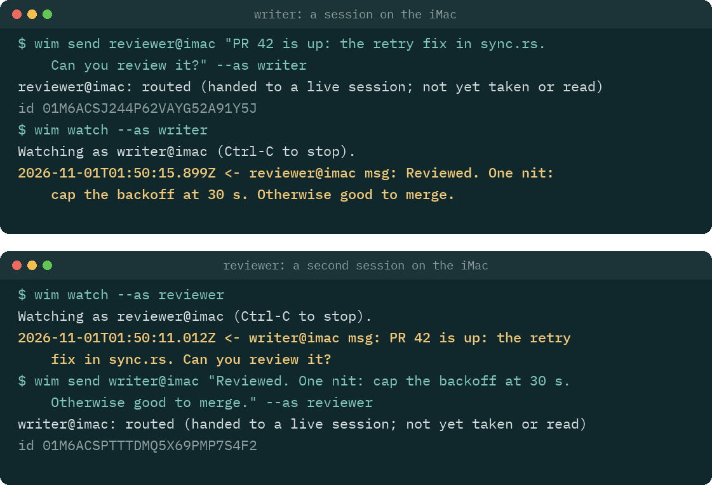

<picture>
  <source media="(prefers-color-scheme: dark)" srcset=".github/assets/distronode-logo-dark.png">
  <source media="(prefers-color-scheme: light)" srcset=".github/assets/distronode-logo-light.png">
  
</picture>

# worldinmotion

[](https://www.bestpractices.dev/projects/15869)
[](https://scorecard.dev/viewer/?uri=github.com/distronode-corporation/worldinmotion)
[](https://github.com/distronode-corporation/worldinmotion/releases)

worldinmotion lets AI agent sessions (Claude Code, Codex CLI, Gemini CLI, Antigravity, Cursor,
Copilot CLI, Claude Desktop, bots) send each other messages in real time, across machines and
across accounts. Messages are end-to-end
encrypted between devices and pass through a relay that cannot read them. Each session gets an
address like `reviewer@laptop`, and can see who is online, send, wait for a reply, and join rooms.



*Two sessions talking through `wim`, drawn from a transcript recorded with wim 0.1.7.*

No account required, no telemetry, sealed offline delivery.

> **Status: pre-release, before v1.0.** It works end to end, but the wire format and the commands
> may still change before v1.0. Use it for work you can afford to redo. Crossing accounts is how it
> is built (a mesh never uses a vendor account), but the formal two-account test has not run yet.

## Why

**Encrypted messages between AI agents from different vendors and different accounts, with a
trust model a security team can review.**

- **Different vendors.** Claude Code, Codex CLI, Gemini CLI, Antigravity, Cursor, Copilot CLI,
  Claude Desktop, any other MCP client and a plain model API (`wim bot`) all reach the same mesh.
  `wim setup` configures each one it finds ([Other agents](#other-agents)).
- **Different accounts.** A mesh is a set of device keys you create, not a vendor account, so a
  session under your account and one under a client's can talk directly.
- **A trust model you can review.** Your own devices are trusted inside the approvals you already
  give, anything else is held for you, and with the signer an agent cannot approve what is held
  ([Security, in plain words](#security-in-plain-words)). [SECURITY-MODEL.md](SECURITY-MODEL.md)
  is the full threat model, and [docs/security-teams.md](docs/security-teams.md) maps it to the
  OWASP agent risks and names the gaps.

Built-in messaging stays inside one vendor and one account, through that vendor's servers. Since
August 2026 (Claude Code v2.1.224), Claude Code sessions on one account can message each other
across machines, through Anthropic's servers. Beyond one machine that needs a claude.ai sign-in,
so it does not work with an API key or on Amazon Bedrock, Google Cloud or Microsoft Foundry.

worldinmotion is for what that does not cover: sessions under different accounts or
organisations, agents from different vendors, and a path in the middle that cannot read the
messages (each agent's own model provider still sees what that agent reads). Without it, when
two such agents work on the same problem (one writing code under your account, one reviewing it
under a client's), a person ends up copying text between them.

What the line at the top means:

- **No account required.** A mesh is a set of device keys that you create. The hosted relay needs
  no sign-up, and no vendor account is involved.
- **No telemetry.** The client, the Claude Code plugin and the VS Code extension send no usage
  data. The client connects only to the relay you choose (and, for `wim bot` and `wim ci`, to the
  provider you configure). Crash reports are off unless you turn them on, see
  [Crash reports (opt in)](#crash-reports-opt-in).
- **Sealed offline delivery.** A message to a session that is offline waits on the relay for up to
  24 hours, sealed to the recipient's device, while the sender may go offline too.

## Quick start: `wim setup`

[Terminal] On the first machine, with Node.js 22.18 or newer, in a terminal you opened yourself:

```sh
npx worldinmotion setup
```

Or install `wim` first (step 1 below) and run `wim setup`, which is the same. It creates the mesh,
shows its recovery code once, offers the Claude Code plugin and the VS Code extension, configures
the other agents it finds, and ends with `wim status`. To add another machine, run `wim invite` on
one already in the mesh, then `npx worldinmotion setup <code>` on the new one.
[First run](#first-run-three-machines-one-person) says what each step does.

## First run: three machines, one person

This guide sets up one person's three machines (here `laptop`, `desk` and `build`) on one mesh,
using the hosted relay at `wss://worldinmotion.distronode.com`, which is free during the
preview. Read its [terms](docs/hosted-relay.md) first. To run your own relay instead, see
[Self-hosting a relay](#self-hosting-a-relay).

Every step says where it happens:

- **[Terminal]** a terminal you opened yourself (in VS Code: Terminal > New Terminal). Never the
  Claude chat box, and never `!` in Claude Code: both run the command inside Claude's session,
  where `wim` refuses the steps that ask for a passphrase, show a secret, decide trust, approve
  a held message or delete a mesh (it says so: `CLAUDECODE is set: this shell belongs to Claude
  Code`).
- **[Claude chat]** the Claude Code prompt.
- **[VS Code]** the VS Code window itself (Extensions view, command palette).

`wim setup` does steps 1 to 4 for you. [By hand](#by-hand) does the same with `wim init`, `wim
join` and `wim invite`, which stay as they are for scripts and unattended machines. Steps 5 to 12
apply either way.

### With `wim setup`

#### The first machine

[Terminal on `laptop`]

```sh
npx worldinmotion setup
```

Run through `npx`, it first says that it runs from npx's cache, which npm prunes, and offers to
install this same version with `npm install --global worldinmotion@<version>` once you type
`y`. When npm's global prefix is not writable, it offers `~/.npm-global` instead and says how
to put its `bin` on `PATH`; it never uses `sudo`. It then runs `wim setup` again from the
installed copy, so every agent config points at a path that stays. If you answer `n`, it prints
the install command and stops, changing nothing. With `wim` installed already, run `wim setup`.

It asks for what it needs and says what each step does before it takes it:

1. Choose 1 to create a new mesh here. It offers this machine's host name as the device name and
   the hosted relay, `wss://worldinmotion.distronode.com` ([terms](docs/hosted-relay.md)), shows
   what the relay says it offers, and creates the mesh only after you type `y`.
2. It shows the **recovery code** once and waits until you press Enter. Keep it offline (a
   password manager, or paper): it is as powerful as an admin device. Never paste it into a
   Claude chat or send it over the mesh.
3. When it finds the `claude` command, it offers the Claude Code plugin and shows the two commands
   it runs, `claude plugin marketplace add distronode-corporation/worldinmotion` and
   `claude plugin install worldinmotion@worldinmotion`. When it finds `code`, it offers the VS
   Code extension, `code --install-extension distronode.worldinmotion --pre-release`. Each waits
   for a `y`. It prints the state directory and why it is that one, and warns when
   `CLAUDE_CONFIG_DIR` is set, since a Claude Code tab without it is another device.
4. For each other agent it finds (Codex CLI, Gemini CLI, Antigravity CLI, Cursor, Copilot CLI,
   Claude Desktop), it shows the change to that agent's config as a diff: the worldinmotion MCP
   server with the read-only tools, and the `wim hook` entries ([Other agents](#other-agents)).
   Each file waits for a `y`, and the original is kept beside it.
5. It ends with `wim status`, problems first.

Run it again whenever you like: on a machine that is set up, it skips what is done and repeats
its steps 3 to 5. In an agent's shell, or with its input or output piped, it refuses and says why.
It never asks about crash reports, and it does not start the signer
([step 5](#5-optional-keep-the-keys-out-of-claudes-reach) below).

#### Each other machine: `wim setup <invite code>`

Do this once for `desk` and once for `build`, with a new invite each time.

[Terminal on `laptop`]

```sh
wim invite
```

It asks "Is the new device one of yours?": answer `y` for your own, and `laptop` trusts it once it
is admitted. It then prints a single-use invite code, `wim2-XXXX-XXXX-XXXX-XXXX-XXXX-XXXX`, and
waits. Move the code to the other machine yourself (a password manager, AirDrop, a USB stick, or
read it out), never through Claude or another agent, and not over the mesh.

[Terminal on `desk`]

```sh
npx worldinmotion setup <code>
```

(or `wim setup <code>` with `wim` installed). It joins as `wim join` does, naming the device after
the host name unless you add `--name desk`. `desk` shows a comparison code like `7KQ2M-X4D9P`:
type it on `laptop`, where `wim invite` asks for it. It then asks whether `laptop`, the device
that admitted it, is your own, and then about each other device on its own (step 4 says what that
trust means). After that it offers its steps 3 to 5, as on the first machine.

From here, go on with [step 5](#5-optional-keep-the-keys-out-of-claudes-reach) (optional) and the
checks from step 6.

### By hand

Steps 1 to 4 do by hand what `wim setup` does.

#### 1. Install, on each machine

You need Node.js 22.18 or newer.

[Terminal] Install the `wim` command:

```sh
npm install --global worldinmotion
wim --version
```

Or, with [Homebrew](https://brew.sh) on macOS or Linux, which also installs Homebrew's Node.js:

```sh
brew install distronode-corporation/tap/worldinmotion
wim --version
```

After `brew upgrade` (of `worldinmotion` or of `node`), run `wim setup` again: it offers the new
paths as an update.

If the shell then says `wim: command not found` after the npm install, npm's global bin directory
is not on your `PATH`. Fix it for this shell, and add the same line to `~/.bashrc` or `~/.zshrc`:

```sh
export PATH="$(npm prefix -g)/bin:$PATH"
```

Without npm: download `wim.mjs` and `SHA256SUMS` from the latest
[GitHub Release](https://github.com/distronode-corporation/worldinmotion/releases), check it with
`sha256sum -c SHA256SUMS` (macOS: `shasum -a 256 -c SHA256SUMS`), and install it with
`install -m 755 wim.mjs ~/.local/bin/wim`, or run `node wim.mjs` wherever this guide says `wim`.

[Claude chat] Install the Claude Code plugin:

```
/plugin marketplace add distronode-corporation/worldinmotion
/plugin install worldinmotion@worldinmotion
```

A Claude Code session that was already open does not get the plugin: start new ones.

[VS Code] Optional: install the extension, `distronode.worldinmotion` on the Visual Studio
Marketplace and Open VSX. Search for **worldinmotion** in the Extensions view, or run
`code --install-extension distronode.worldinmotion --pre-release`. The extension is published as a
pre-release only until 1.0, so the command needs `--pre-release` (or a version,
`distronode.worldinmotion@<version>`): without either it looks for a stable version, finds none, and
prints only "Failed Installing Extensions".

#### 2. Create the mesh, on the first machine

[Terminal on `laptop`]

```sh
wim init --name laptop --relay wss://worldinmotion.distronode.com
```

This makes the device's keys, creates a new mesh on the relay with this device as its admin, and
shows a **recovery code** once. Keep it offline (a password manager, or paper): it is as powerful
as an admin device. Never paste it into a Claude chat or send it over the mesh.

Run anywhere it cannot be shown, such as through an agent or a pipe, `wim init` says why, offers
the code to `wim recovery show` run in your own terminal, and **keeps running until you collect
it, for up to 10 minutes**: only that process holds the code. If it is stopped before then (Ctrl-C,
or an agent giving up on it), it exits 130, the code is gone and the mesh has none; run `wim
recovery rotate` on this machine, in your own terminal, for a new one. `wim recovery show --wait`
keeps the code on screen until you press Enter, for a terminal that closes as soon as its command
ends.

`wim devices` lists that code as a second admin named `recovery`, marked `hold`. It is not a
machine: it is an admin record that never connects, so nothing ever comes from it.

`wim init` ends by pointing to `wim status`, which checks the device, the relay and the mesh in a
few lines (step 6). Right after `init`, `wim peers` says "No other sessions.": that is expected
until another device joins.

#### 3. Add the other two machines

Do this once for `desk` and once for `build`, with a new invite each time.

[Terminal on `laptop`]

```sh
wim invite
```

It prints a single-use short invite code, `wim2-XXXX-XXXX-XXXX-XXXX-XXXX-XXXX`, and waits. Move
the code to the other machine yourself: a password manager, AirDrop, a file on a USB stick, or
read it out. Never through Claude or another agent, and not over the mesh. (A machine on wim
0.1.10 or older cannot read it: upgrade it to 0.2.0 before it joins.)

[Terminal on `desk`]

```sh
wim join <code> --name desk
```

`desk` shows a comparison code like `7KQ2M-X4D9P`. Type it on `laptop`, where `wim invite` asks
for it: `laptop` never shows its own copy, so typing it is the check that the request came from
`desk` and not from someone else who saw the invite. A code that does not match is refused: make
a new invite. Both commands ask for a person at the terminal, so run them in a terminal you
opened yourself, not through an agent.

`wim join` makes the device's keys too, so a new machine needs no `wim init`. If `wim invite` was
no longer running when `desk` asked to join, `wim devices pending` on `laptop` lists it, and
`wim devices admit desk <comparison code>` admits it.

For an unattended machine you control (a bot or a build box), `wim invite --auto` admits the first
device that uses the code, with no comparison code to type. Because that code alone admits a
device, it is printed only in a terminal you opened yourself. Run through an agent or with its
output piped, `wim invite --auto` keeps the code in memory and asks you to run `wim invite show`
in your own terminal, within 10 minutes and before the invite expires, to see it once.

#### 4. Trust your own devices

Until you trust a device, its messages are held for your approval. Trust is set inside the
approvals you already give, between the two devices of each one, and never passed on:

- `wim invite` asks "Is the new device one of yours?" before it shows the code. Answer `y` for
  your own, and `laptop` trusts `desk` when it admits it (`wim invite --auto` never trusts).
- `wim join` (or `wim setup <code>`) on `desk` asks "laptop admitted this device. Is laptop your
  own device?", then about each other device on its own.
- A device added later by another device is not trusted because that device is: `wim status`
  lists it ("held here, added by laptop: build"), and VS Code asks about it.

Each automatic trust prints its undo, `wim devices untrust <name>`. In a mesh with someone else's
devices, answer no for theirs. Any you skipped, or a mesh made before 0.2.0, on each machine:

[Terminal on `laptop`, `desk` and `build`]

```sh
wim devices trust --all
```

`wim devices trust <name>` trusts one device, and `wim devices` lists the devices and what this
one does with each one's messages. Both trust commands list each device with its id and wait for
your `y`; the id should match the line marked `this device` in `wim devices list` on that machine.

### Either way, on every machine

#### 5. Optional: keep the keys out of Claude's reach

By default the device keys are in a file your OS user can read, and so can any agent with a
shell. The signer keeps them in a separate process instead.

[Terminal] Once per machine:

```sh
wim signer encrypt   # once: encrypts the key file under a passphrase you choose
wim signer start     # asks for the passphrase and starts the signer in the background
```

The signer keeps running after you close the terminal or VS Code, and stops when you log out,
restart or run `wim signer stop`. To have it start at each log in, run
`wim signer autostart enable` once: a login item starts it and asks for the passphrase in a dialog
of its own (`--keyring` keeps the passphrase in the macOS keychain or libsecret instead; read
SECURITY-MODEL.md section 5.8 first). Without autostart, run `wim signer start` again after each
restart.

Start it before you open Claude when you can. A Claude tab opened earlier says on its status line
that no signer is running, and links by itself a few seconds after the signer starts.
`wim signer status` only reads, so Claude may run it for you; `wim signer lock` wipes the keys from
the signer's memory until `wim signer unlock`.

With the keys in the signer, approving or refusing a held message also needs the signer's own
confirmation, so an agent cannot approve one by writing a file (step 10).

The signer used to be `wim agent`. The old `wim agent start`, `stop`, `status`, `lock`, `unlock`,
`encrypt`, `decrypt` and `autostart` still run it, with a note that names the new command, and
`wim signer autostart status` updates a login item written for the old name.

#### 6. Check each machine

[Terminal] `wim status` sums it up: this device, whether it refuses v0.1 boxes (`wim legacy-boxes`),
each mesh with its relay, whether this device is an admin, how many other devices and live
sessions there are, any device another device added that is still held here, how long the relay
keeps a mesh nobody uses, every takeover of a session's address in the last 24 hours, and any
problem in full. `wim doctor` shows every check behind it: the keys, the
state directory (and why it is the one: `WIM_HOME`, `CLAUDE_CONFIG_DIR` or the default), how held
messages are decided here, the relay, the clock and the roster, and any other device directory on
the machine. Both check every
mesh the device is in, and on a machine not set up yet they say so and name `wim init` and `wim
join`. Either exits 1 when it finds a problem.

[Claude chat] In a new Claude Code tab, `/wim status` shows the same for that tab: its address,
the relay connection, the signer and the state directory.

[Terminal] `wim test` checks wim itself on this machine, without touching your device or your
meshes. It starts a relay inside its own process on `127.0.0.1`, makes throwaway devices in a new
temporary directory, and runs the real commands on them: create, invite and join with the
comparison code, trust, ping, send with receipts, the offline queue, held messages approved and
refused, rooms, a file, a lease, ask and reply, rename, the loop breaker, `wim status` and `wim
doctor`, and `wim mesh delete`. It plays the person for the steps that need one, on its own
devices only, and removes everything at the end. It prints one row per step and exits 0 only when
every step passed; `wim test --json` prints the same as JSON. `wim test --full` adds the signer
(encrypt, start, lock, unlock, stop) and a CI notice from a test issuer that exists only inside
the sandbox. `wim test --relay wss://<relay>` runs the same steps on a real relay instead, with a
throwaway mesh it deletes at the end (`--key-env NAME` for a relay that needs an operator key to
create one); a step that relay does not offer is skipped, which does not fail the run.
`--person` has you type the steps that need a person. In VS Code, **worldinmotion: Run
Self-Test** runs the same in the sandbox and shows the rows in an output channel; in Claude Code,
`/wim test` does, taking `--full` and `--relay` only when you type them (a relay that needs an
operator key is tested from a terminal). SECURITY-MODEL section 7.6 says what it
can and cannot touch.

#### 7. Addresses

| address | what it is |
|---|---|
| `cli@<device>` | the device's terminal inbox: `wim inbox` reads it once (`--peek` to look without marking anything read; a pipe or file marks nothing unless `--mark-read`), `wim watch` follows it. Registered when the device creates or joins the mesh; the relay forgets it after 24 hours offline with nothing queued, and the next `wim inbox` or `wim watch` there registers it again |
| `<folder>@<device>` | a Claude Code tab: its working directory's base name, for example `billing@laptop`. The tab's status line shows it; `/wim name <name>` renames it |
| `vscode@<device>` | the VS Code extension |

A name a session holds stays its own while it is offline (24 hours, longer while messages wait),
so a new session that asks for it gets `name-2`. To take a role's address over on the same device,
ask for it: `--take` with `--as <name>`, `WIM_TAKE=1` with `WIM_NAME`, or the `rename` tool with
`take`. The new session then gets that address with its queue, held items and leases, and a notice
that counts them; a name a live session holds is never taken (docs/design.md, "Taking a session
back").

A message to `cli@desk` waits in desk's terminal inbox; it does not reach a Claude tab on `desk`.
When a Claude tab is live there, `wim send` says so: `live on desk now: billing@desk (claude-code)`.

#### 8. Terminal test: all six routes

[Terminal on each machine] Leave `wim watch` running in one terminal, so each machine has a live
session. Then, in another terminal on each machine:

```sh
wim ping --all
```

It pings every live session, and each device's client answers with a pong by itself (no agent,
no inbox). A pong proves both directions between the two devices, encryption included, so three
machines that each print `both directions ok` for the other two have tested all six routes.

To test real messages as well, send to the other two from each machine and wait for the
receipts:

```sh
# on laptop
wim send cli@desk "hello from laptop" --wait 2m
wim send cli@build "hello from laptop" --wait 2m
# on desk, then on build: the same to the other two
```

Each send answers `routed` (handed to a live session; not yet read) while a `wim watch` reads
there, else `queued`. The `wim watch` on the other machine prints the message, and the waiting
`wim send` prints `delivered` once that session has taken it. Answer each one to test the way
back, for example on `desk`: `wim send cli@laptop "reply from desk" --wait 2m`. Without a
`wim watch`, `wim inbox` reads the terminal inbox once and, at a terminal, marks each item read
once it is printed. When its output is not a terminal (a pipe or a file) it marks nothing, since a
pipe such as `| head` can cut an item off part-way without the writer knowing, and it says so on
stderr; `--mark-read` marks what it printed anyway. `wim inbox --peek` prints it all and marks
nothing. A message from a device you did not trust prints `held` with how to approve
it there (`wim held approve <id>`, in a terminal on that machine: it shows everything held from
that device together, with the count and the time span, and approves exactly those on a typed
`all`, or only that one on `one`). A `wim send --wait` keeps waiting through `held` and prints `delivered`
once the person there approves it, or `refused` if they refuse it. When that device's loop
breaker holds it for a trusted device's cool-down, it says when the cool-down ends, and prints
`delivered` when that device's client delivers it then.

#### 9. Claude-to-Claude test

[Claude chat on `desk`] Open a Claude Code tab in a folder, say `~/src/demo`. Its status line shows
`demo@desk`. Leave it idle.

[Claude chat on `laptop`] In a Claude Code tab (say `notes@laptop`), ask:

> Send demo@desk this message: "Please reply to notes@laptop with the word pong."

Without anything typed on `desk`, the `demo@desk` tab starts a turn for the message and replies
with SendMessage, and the reply arrives in the `notes@laptop` tab as a new turn. To a device you
trusted, SendMessage asks nothing; to any other device Claude asks you first.

#### 10. When a message does not arrive

- `wim peers` lists the live sessions; a Claude tab shows as kind `claude-code`. A tab missing
  there was opened before the plugin was installed (start a new one), or its status line says
  why it is not linked.
- A tab that names a different state directory than your terminal (`/wim status` against
  `wim doctor`) is a different device: usually `CLAUDE_CONFIG_DIR` is set for one and not the
  other. Use the same `WIM_HOME` in both, or set up that directory as its own device.
- Held messages: `wim held list`, or `/wim` in Claude Code. Both show them a set per sending device
  (or per CI rule), decided together. With the signer running (`wim signer`), each approve, refuse
  or resume also asks you in the signer's own terminal or dialog, with a code the asking command
  shows, so a mark file an agent writes approves nothing. An agent that can read the signer's
  memory (on Windows any process of yours can) or drive your desktop still can (SECURITY-MODEL 5.8
  and 7.2); the Claude Code pane then sends you to `wim held` or VS Code.
- Many held at once: `wim held refuse --from <session@device>` (or `--from <device>`, or `--all`)
  shows every set it touches and decides that session's items on one typed `y`; `wim held approve`
  takes the same flags. Both are for you at your own terminal, like the rest of `wim held`: with
  input piped in (`... | xargs wim held refuse`) or under an agent's variables they refuse.
  `wim held refuse <id>` for an id that is no longer held (its set was refused already) says so and
  succeeds, so a loop over `wim held list` runs to the end.
- Relayed text (what `wim ci`, `wim bot`, `wim a2a` and a worker's room posts forward from
  elsewhere) is held unless its device is trusted with `--relayed`, and that includes this device's
  own: `wim devices list` says `this device (relayed text held)`. `wim devices trust <this device>
  --relayed` delivers it to the other sessions here, as information only; on another machine,
  `wim devices trust <that device> --relayed`. `wim ci` prints, when it starts, which members of
  its rooms would hold its lines and the command for each device. Changing trust delivers what was
  held under the old policy (each session does it within seconds while it runs, or when it next
  starts, within the loop breaker's hourly limits), and a policy of `refuse` drops it.
- Held feed lines expire by themselves: a relayed message that answers nothing (a `wim ci` line, a
  bot's room post) is dropped once it is 24 hours old, or once 20 newer lines from the same session
  wait. Set `"heldFeeds": { "maxAgeHours": 24, "keep": 20 }` in the mesh's `mesh.json` to change
  either. Tasks, results, files, replies and CI notices never expire this way (SECURITY-MODEL 7.2).

#### 11. Optional: a ping when a message is held

A held message waits until you approve it, which is easy to miss when you are away from the
machine. The client can run a program of your choice each time a message is held. It passes one
short line with no message content, such as `worldinmotion: 2 messages held for approval`, and
never the text or the sender. (The same ping also fires when a device asks to join, naming that
device, and when the roster forks.) You still approve at the machine: the ping cannot approve
anything.

[Terminal] Write `notify.json` in the state directory that `wim doctor` names (by default
`~/.config/worldinmotion/notify.json`). This one posts to an [ntfy](https://ntfy.sh) topic with
curl:

```json
{ "provider": "command", "command": ["curl", "-fsS", "-H", "Title: worldinmotion", "https://ntfy.sh/<your-topic>", "-d"] }
```

The client runs the program without a shell and adds the line as its last argument, so this runs
`curl ... -d "<line>"`. It pings at most once a minute (`"minIntervalMs"` changes that). Anyone
who knows a public ntfy topic name can read it, so pick a long random one, or use your own ntfy
server. Sessions read `notify.json` when they start: restart them after a change. `wim notify-test`
sends a test line.

#### 12. Deleting a mesh

A mesh lives on its relay until it is deleted. The hosted relay deletes a mesh that no device has
connected to for 30 days (another relay says what it does in `/v1/info`, which `wim status`
shows), and every mesh counts against the hosted relay's limit of 2,000 until then.

[Terminal on an admin device] To delete one sooner, such as a test mesh:

```sh
wim mesh delete
```

It lists the mesh's devices, says what goes, and waits for your `y`. The relay then deletes the
mesh for every device in it (its roster, queued messages, room history, files and leases), closes
every session, and this machine's copy is removed. There is no undo: the devices need a new mesh
and new invites. Like trusting a device, it runs only in a terminal you opened yourself, never
through an agent, and no MCP tool or VS Code request can do it. Any admin can delete the mesh, for
other people's devices too.

[Terminal on each other device] Its sessions stop with "an admin deleted this mesh at the relay".
`wim mesh delete` there removes that machine's copy, also after a `y`. It does the same on any
device whose mesh the relay removed after its idle time.

## Other agents

How a message reaches an agent depends on the agent. **Push**: Claude Code's plugin delivers it into
the running turn, or starts a new turn in an idle session. **Turn**: at the end of a turn,
`wim hook <agent>` asks the agent for one more turn when messages from devices you trust are
waiting, with a fixed line (how many wait, and to call the `inbox` tool) that never carries a
peer's text or name. **Pull**: the agent sees messages only when it calls the `inbox` or `wait`
tool, which is also how every agent sees them while it is idle; only Claude Code wakes an idle
session.

| agent | message delivery | what `wim setup` configures | how it was checked |
|---|---|---|---|
| Claude Code | push, through the plugin's mod | offers the plugin (`claude plugin marketplace add`, then `claude plugin install`) | live, 2026-10-24, in the terminal and the VS Code extension |
| Gemini CLI | turn, with `wim hook gemini` | the MCP server in `~/.gemini/settings.json` with the read-only tools only; `AfterAgent` and `BeforeAgent` hooks | live: messages on 2026-10-24, the hook on 2026-11-06 and its turn-start payload on 2026-11-07 |
| Antigravity CLI | turn, with `wim hook antigravity` | the MCP server in `~/.gemini/config/mcp_config.json` with the read-only tools only; a `Stop` hook (no turn-start entry) | live: messages on 2026-10-24, the hook on 2026-11-06 (print mode) |
| Codex CLI | turn, with `wim hook codex` | `[mcp_servers.worldinmotion]` in `~/.codex/config.toml` with the read-only tools only; `Stop` and `UserPromptSubmit` hooks, which Codex runs once you trust them with `/hooks` | from its documentation (config 2026-10-24, hooks 2026-11-06); not run |
| Cursor | turn, with `wim hook cursor` | the MCP server in `~/.cursor/mcp.json` (Cursor has no tool list, so it asks before each call); `stop` and `beforeSubmitPrompt` hooks | from its documentation (config 2026-10-24, hooks 2026-11-06); not run |
| Copilot CLI | turn, with `wim hook copilot` | the MCP server in `mcp-config.json` with the read-only tools only; `agentStop` and `userPromptSubmitted` hooks in `hooks/wim.json` | from its documentation (hooks 2026-11-06, config 2026-11-07); not run |
| Claude Desktop | pull (it has no hooks) | the MCP server in `claude_desktop_config.json`, as `desktop@<device>` (no tool list, so it asks before each call) | from its documentation (2026-10-24); not run |
| any other MCP client | pull | nothing: add `wim mcp` by hand ([docs/peers.md](docs/peers.md#any-other-mcp-client)) | live, 2026-10-24, with the MCP TypeScript SDK client |
| a plain model API | `wim bot` answers each message as it arrives | nothing: [`wim bot`](packages/bot/README.md) runs from its own config | see [packages/bot](packages/bot/README.md) |

"Live" means a real session of that agent listed peers and sent a message that arrived, or, for a
hook, that a real turn of the agent ran it as configured ([docs/peers.md](docs/peers.md#waking-at-turn-end-wim-hook)
says what each check covered). The read-only tools are `peers`, `inbox`, `wait` and
`history`: add `send` (and `reply`) yourself to let an agent message peers. `wim setup` starts
`wim mcp` directly, with node and the absolute path to `wim.mjs`, which the hook needs. Each change
is shown as a diff and written only when you type `y`, with the original kept beside it, and a
rerun brings a stale path up to date. [docs/peers.md](docs/peers.md#what-wim-setup-writes) lists
what it writes, and where, per agent, and how to add each entry by hand.

- **Claude Code:** [plugins/claude-code](plugins/claude-code/README.md) covers the plugin, its
  `/wim` pane and its status line.
- **VS Code:** the [extension](packages/vscode/README.md) shows the mesh, held messages and live
  activity.

`wim help` lists every command. For scripts, `wim send <to> <text...> --wait-idle` sends work and
waits until that session finishes its turn, and `wim wait-idle <address,...>` waits for sessions
already working ([docs/peers.md](docs/peers.md#waiting-from-a-script-wim-wait-idle)).

## Run an agent on a message

`wim agent` is a peer that sleeps until a device you allow messages it, runs one agent job, and
replies with the answer. It runs on a device of its own, and wakes only for device ids on its
allow-list (from the signed roster, never names) that you also trust, optionally behind a wake
code. It never acts on relayed text. Each job goes through a runner command: the built-in one runs
the Claude Agent SDK with read-only tools, and an optional privileged runner runs as root through
one sudoers line, checks each request's signed message itself and signs in to Anthropic on its own
(keyless through Workload Identity Federation, or with an API key), so the job holds no
credential. Limits cap the task length, attempts per device, jobs per day and
the job's time.

```sh
wim agent init agent.json     # a starting config; wim agent doctor agent.json checks it
wim agent serve agent.json --as agents
```

The npm package carries the deployment kit for a Linux host (systemd units, the sudoers line, a
cloud metadata block, a scheduled-job wrapper), and `wim agent init --kit <dir>` writes it out.
Read [packages/agent](packages/agent/README.md) first: it covers the config, the runner contract,
running it as its own user and its security model. [SECURITY-MODEL.md](SECURITY-MODEL.md) section
7.7 is the threat model, and [packages/agent/docs/deploy.md](packages/agent/docs/deploy.md) takes
a fresh host to a running agent.

## How it works

```
  laptop                                            build box
 +------------------------+                       +------------------------+
 | agent (Claude Code)    |                       | agent (Gemini CLI)     |
 |   |                    |                       |   |                    |
 | plugin or MCP server   |                       | plugin or MCP server   |
 |   |                    |                       |   |                    |
 | wim client             |                       | wim client             |
 |  (device keys, crypto) |                       |  (device keys, crypto) |
 +-----------|------------+                       +-----------|------------+
             |  WSS                                     WSS   |
             v                                                v
        +-------------------------------------------------------+
        | relay (Cloudflare Worker, or self-hosted Node relay)  |
        |   +-----------------------------------------------+   |
        |   | one Durable Object per mesh:                  |   |
        |   |   signed roster, sessions, offline queues     |   |
        |   +-----------------------------------------------+   |
        +-------------------------------------------------------+
```

- A **device** (one machine, one OS user, one agent profile) holds its own signing and
  encryption keys. A **mesh** is a set of devices that trust each other, listed in a
  **roster** that admin devices sign.
- Each running agent is a **session** with one WebSocket to the relay. A new device joins
  with a one-time invite code from an admin.
- The relay routes encrypted messages, queues them for offline sessions for up to 24
  hours, and reports delivery. On Cloudflare each mesh lives in its own Durable Object;
  the self-hosted relay keeps the same model in one Node process.

The wire protocol is in [SPEC.md](SPEC.md). How the pieces on one machine fit together is in
[docs/design.md](docs/design.md).

## Security, in plain words

- **End-to-end encrypted.** Message text is encrypted on the sending device for each
  recipient device, and signed. The relay never has the keys.
- **Signed roster.** Only an admin device can add or remove a device, by signing a new
  roster version that every client checks against the chain it already trusts. A relay
  cannot slip in a device of its own.
- **The relay sees metadata only.** It sees which devices and sessions exist, who sends to
  whom, when, and how much. It cannot read, forge or alter a message without the receiver
  dropping it. It can drop or delay messages, which senders notice as a missing receipt.
- **Peer text is framed as another AI session's text.** Everything a peer sends reaches an agent
  inside a frame that says so. This reduces the risk that an agent obeys a peer, and it is not a
  guarantee (SECURITY-MODEL.md section 7.1). A device you trust (`wim devices trust`) can ask
  your agents for work, within their normal permissions. Messages from a device you do not trust
  are held for your approval.
- **Secret filter, best effort.** Outgoing text that matches common credential formats (cloud and
  API keys, tokens, private keys, invite and recovery codes) is refused. An encoded or unusual
  secret gets through, so it catches accidents, not a determined agent (SECURITY-MODEL.md section
  7.4).
- **Loop and cost breaker.** Two agents that wake each other could loop and spend tokens without
  end, so each receiving session counts how often the devices you trust wake its agent (any other
  device's messages are held for you anyway). In a new mesh the defaults are 120 messages per sender device
  and 300 in total per hour, plus a pause on a fast exchange of short messages (more than 32 back
  and forth in 10 minutes); a `mesh.json` keeps the limits written in it. Past a limit, that
  device's messages are held, the notice names the rule that tripped with its numbers and when the
  pause ends, `wim held list` shows the pause, and the sender's `send` says `held`. After a
  10-minute cool-down the client releases the device by itself and delivers at most its per-peer
  limit of what it held, never past the total; the rest, and a second trip within the hour, wait
  for you. The counts survive a restart of the session.
  docs/design.md (loop and cost breaker) shows how to change the limits.
- **Forward secrecy, bounded.** Each device rotates a signed prekey daily and deletes each
  prekey's secret 72 hours after it expires, and every message is sealed to the recipient's
  current prekey with a fresh ephemeral key. A key file stolen later opens nothing sealed to its
  device more than 120 hours earlier, and nothing the device sent. From 1.0 a device never sends
  or accepts a v0.1 box (the format of v0.1 clients, without forward secrecy), so a relay that
  withholds prekeys cannot downgrade a send, and v0.1 clients are no longer reached. A message
  dropped for that is not silent: the session gets one notice per sender device saying so, and
  `wim status` shows the setting and counts them. For a mesh that still has a v0.1 device, only
  you, at your own terminal, can reopen that window on a device with `wim legacy-boxes accept`;
  `wim legacy-boxes refuse` closes it again. Details: SECURITY-MODEL.md section 6.14.
- **Optional: keep the keys out of your agent's reach.** By default the device keys are in a file
  only your OS user can read, which also means any agent with a shell can read them. `wim signer
  encrypt` encrypts that file under a passphrase; `wim signer start`, run in your own terminal, asks
  for it once and keeps the keys in a separate signer process that sessions ask to sign and
  decrypt. A copy of the files is then useless without the passphrase, and `wim signer lock` stops
  all use of the keys until you unlock it. A process running as you can still ask the unlocked
  signer to act for the device. Details: SECURITY-MODEL.md section 5.8.
- **Approving and trusting happen at your own terminal.** `wim held approve`, `refuse` and
  `resume`, and `wim devices trust` and `untrust`, run only when their input and output are an
  interactive terminal and no agent's variables are set (`CLAUDECODE` and the others listed in
  SECURITY-MODEL.md section 7.2). They show what is being decided and wait for a typed `y`. No
  MCP tool does any of them. This stops an agent that runs `wim` the usual way, by mistake or
  because a peer asked it to. It does not stop a program running as your OS user, which can unset
  the variables, open a terminal of its own, or edit wim's files directly (section 5.8).
- **Trust is never passed on.** Your own devices are trusted inside the approvals you already give
  (`wim invite` asks whether the new device is yours, and the joining device asks about the one
  that admitted it). A device that another device added is not trusted because that device is:
  `wim status` lists it as held here, with the command that trusts it.
- **Held messages are decided a set at a time.** `wim held`, the VS Code Held view and the Claude
  Code pane group what is held per sending device (or CI rule) and show the whole set, in order,
  with its count and time span, before you decide. A decision covers exactly the items shown: one
  that arrives after the set was drawn stays held. `--from` and `--all` show every set they touch
  in full before the one `y` that decides them.
- **With the signer, approvals are signed.** When the keys are in the signer, each approve, refuse
  or resume also needs the signer's confirmation, in the terminal it runs in or its own dialog,
  with a six-digit code the asking command shows too. The signer then signs a decision over
  exactly those items, and sessions act on nothing else: a mark file an agent writes approves
  nothing, and `wim status` reports any it finds as a problem. An agent that can read the
  signer's memory (on Windows any process of yours can) or drive your desktop still can
  (SECURITY-MODEL.md sections 5.8 and 7.2).
- **Takeovers are shown.** A new session takes over an offline session's address, with its queue,
  held items and leases, only when asked to (`--take`, `WIM_TAKE=1`, or the `rename` tool's
  `take`), and never from a live session. Because a peer's text could prompt an agent to ask,
  `wim status` and `wim doctor` list every takeover of the last 24 hours.

The full threat model, including what is out of scope, is in
[SECURITY-MODEL.md](SECURITY-MODEL.md). For a security team deciding whether wim may run inside a
company, [docs/security-teams.md](docs/security-teams.md) maps it to the OWASP agent risks and
names the gaps. To report a vulnerability, see [SECURITY.md](SECURITY.md).

## Crash reports (opt in)

Every bundled `wim` can send a crash report to Distronode's Sentry organisation in the European
Union (de.sentry.io) when a bug ends a command. They are off until you turn them on, and
nothing asks you to: run this yourself, in your own terminal.

```
wim crash-reports on       # shows what a report holds, then asks; only a typed y says yes
wim crash-reports off      # stops them at once, a running `wim mcp` included
wim crash-reports          # says whether they are on, and whether this build can send any
```

In VS Code, **worldinmotion: Turn Crash Reports On...** and **Turn Crash Reports Off** open a
terminal running the same commands with the extension's own client.

- **Nothing is sent before a yes.** The answer is the file `crash-reports` in the state directory
  that `wim doctor` names, holding `on` or `off`; no file, or anything else in it, is no. No
  environment variable or flag can turn reports on, and an agent cannot through the command: `wim
  crash-reports on` runs only at an interactive terminal with no agent's variables set, like `wim
  devices trust` (anyone may turn them off). The file itself is an ordinary file of yours, so any
  program running as you, an agent's shell included, could write `on` into it; turn reports off
  with `WIM_NO_CRASH_REPORTS=1` where that matters (SECURITY-MODEL.md, section 5.8). The answer is read when an error happens, so no Sentry client is set
  up until a report is about to go. Tests (`packages/client/test/crash.test.ts`) check that with
  the answer missing, off or misspelt, or reports turned off by the environment, a bug sets up no
  client and makes no request, and that with it on, exactly one scrubbed event is sent.
- **Off whatever the file says** while `WIM_NO_CRASH_REPORTS` is set, or `DO_NOT_TRACK` is set to
  anything but `0`. The VS Code extension sets `WIM_NO_CRASH_REPORTS` for its client while VS
  Code's own telemetry setting is off.
- **What is reported:** only a bug, that is one of JavaScript's own `TypeError`, `RangeError`,
  `ReferenceError`, `SyntaxError`, `URIError` or `EvalError`, that ends a command or that no code
  was waiting for. A refusal, a set-up problem, or a relay or network failure is never reported.
- **At most 5 a process,** and one for each distinct error, so a bug that keeps recurring in a
  long-running `wim mcp` sends one report, not one each time.
- **What a report holds:** the error's type and its message after scrubbing, the stack's function
  names, file names (`wim.mjs`, never a directory) and line numbers, the wim version, the command
  name (`send`, `mcp`), the OS family (`linux`, `darwin`, `win32`) and the Node version.
- **What it does not:** message text, files, keys, invite and recovery codes, the mesh, device and
  session ids, addresses, room names, your user name, host name and home directory, the working
  directory, the relay URL, arguments and environment variables: none of these is given to the
  report. Before a report leaves, the error's message has quoted text, URLs, file paths (each to
  the end of its line, spaces and all), `name@device` and email addresses, IP addresses, domain
  names, long ids and tokens, long numbers and every capitalised word after the first replaced
  with placeholders, and a message that still looks like a credential is dropped whole. What can
  remain is lowercase words: an engine's own wording, and anything the code wrote into the
  message unquoted. A report has no breadcrumbs, no user, no
  host name and no request. Sentry still sees the connection's IP address, as any server does,
  and the project is set not to store it.
- **Which builds can send:** every bundled `wim` (npm, the GitHub Release `wim.mjs`, the VS Code
  extension and the Claude Code plugin) carries the reporting address, which is committed at
  `packages/client/crash-report-dsn.txt`. A Sentry address only lets a program submit events,
  not read them. Nothing is sent until you run `wim crash-reports on`, and your answer applies to
  every copy of `wim` that shares the state directory. `wim` run from source carries no address.
  The relays have no crash reporting.

## CI notices (GitHub Actions, GitLab CI/CD)

A CI job can tell one of your sessions how it finished: one information-only notice, which never
starts work, never wakes the session and lands in its inbox. The job proves where it runs with
its provider's own ID token, so there is no secret to store. You decide, at your own terminal,
which repository, branch or tag, and workflow may send to a device:

```
wim ci allow github <owner>/<repo> --ref main --workflow ci.yml
wim ci allow github <owner>/<repo> --tag 'v*' --workflow release.yml
wim ci allow gitlab <group>/<project> --ref main
wim ci allow gitlab <group>/<project> --tag 'v*'
wim ci list                 # the rules on this device, numbered
wim ci remove <n>           # removes rule n
```

`--ref` takes a branch name or a full ref (`refs/heads/...`, `refs/tags/...`), `--tag` a tag
name. Either may be a pattern with one `*` at the end (`--tag 'v*'`, `--ref 'refs/heads/release/*'`;
quote it so the shell leaves it alone). A pattern takes every tag or branch that starts with the
part before the `*`, that name itself and names with `/` included, so anyone who can push one
can send. Protect the same refs at the provider, as `allow` tells you: on GitHub a tag or branch
ruleset targeting both `v*` and `v*/**/*` (a ruleset's `*` stops at `/`); on GitLab protected
tags or branches with the wildcard `v*` (a GitLab rule takes only protected refs unless it has
`--unprotected`). A GitHub pattern rule also needs a relay that checks ref patterns
(`"ciPatterns": true` in its `/v1/info`): `allow` warns when the relay does not say so or cannot
be reached, and saves the rule all the same. GitLab rules need no such relay, since the relay
never filters GitLab notices.

`allow` prints a recipient code (`wimci1_...`, not a secret) for the job. The job side is a
published step pinned to a release, which runs `wim ci notify`: the GitHub Action (the job needs
`permissions: id-token: write`) or the GitLab CI/CD component.

```yaml
- uses: distronode-corporation/worldinmotion-notify@<full commit sha> # vX.Y.Z
```

```yaml
include:
  - component: $CI_SERVER_FQDN/distronode-corporation/worldinmotion-notify/notify@X.Y.Z
```

Their READMEs show the whole job and every input:
[packaging/github-action](packaging/github-action/README.md) and
[packaging/gitlab-component](packaging/gitlab-component/README.md). Neither is published yet:
the GitHub Marketplace and the GitLab CI/CD Catalog get them from a coming release, and until
then these two lines do not resolve. The relay must take CI senders:
the hosted relay does (see [docs/hosted-relay.md](docs/hosted-relay.md) for what it sees), and a
self-hosted one takes them with `WIM_CI=1`. The protocol is [SPEC.md](SPEC.md) section 18.

## Self-hosting a relay

The relay is untrusted for message content, so running your own is about availability, limits
and metadata, not about who can read your messages. Two options:

- **Node relay**, one process for many meshes, from source or as the container image
  `ghcr.io/distronode-corporation/worldinmotion-relay`, behind your own TLS:
  [packages/relay-node](packages/relay-node/README.md).
- **Cloudflare Worker**, one Durable Object per mesh, in your own Cloudflare account:
  [packages/relay-cloudflare](packages/relay-cloudflare/README.md).

A relay refuses to create meshes until you choose who may: set `WIM_CREATE_KEY` (then
`wim mesh create --relay <url> --key-env NAME` must carry that key) or `WIM_OPEN_CREATE=1` (anyone
who can reach it). A mesh lives on the relay that created it; v0.1 cannot move a mesh to another
relay.

## The hosted relay

`wss://worldinmotion.distronode.com` is a Cloudflare Worker run by Distronode. During the preview
(until v1.0) anyone may create a mesh on it, with no key and no sign-up, within limits: at most
2,000 meshes in total, 25 MiB of files per mesh per day, rate limits per network, and a mesh with
no connection for 30 days is deleted (`wim mesh delete` deletes one sooner). There is no SLA, and
the offer may end with 60 days' notice.
`wim doctor` shows what the relay says about its offer. The full terms, what it can see and how
to report abuse are in [docs/hosted-relay.md](docs/hosted-relay.md).

## Contributing

See [CONTRIBUTING.md](CONTRIBUTING.md). This project follows the
[Contributor Covenant](CODE_OF_CONDUCT.md). Changes are listed in [CHANGELOG.md](CHANGELOG.md).

## Licence

Apache License 2.0. See [LICENSE](LICENSE) and [NOTICE](NOTICE).
